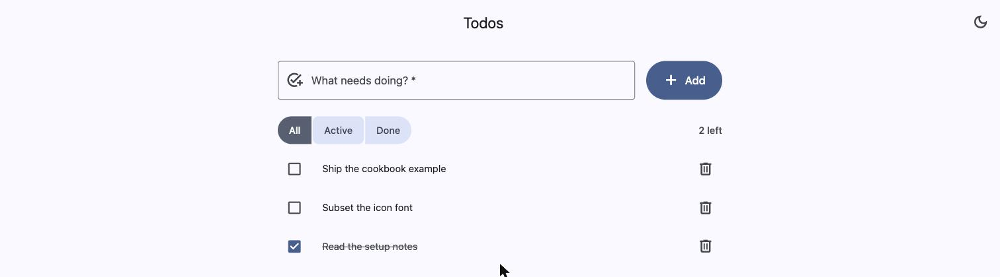

# A todo app in Material 3, htmx and FastAPI

Add, toggle, delete, filter. No frontend framework and no client-side model of a todo — the server
renders every piece of the page, including the pieces that change one row at a time.



The toggle in the app bar switches the whole page — components included — by swapping one class on
`<html>`.

- **[advanced-material-web](https://www.npmjs.com/package/advanced-material-web)** ≥26.30.0 — Material 3
  as custom elements; eight of them here
- **Tailwind v4** — layout around the components, themed from the same Material tokens
- **htmx** — every interaction is an HTTP request that returns HTML
- **FastAPI + Jinja2 + SQLite** — five endpoints, all returning HTML

## Run it

```sh
npm install
npm run build           # bundles the components, compiles the CSS, subsets the icon font
uv run uvicorn app.main:app --reload
```

<http://localhost:8000>. `npm run build` first — it creates `app/static/`, which FastAPI mounts at
startup. `npm run watch:css` / `watch:js` rebuild while working. Tests: `uv run pytest`.

## What the browser downloads

| File | Raw | gzip | |
|---|---|---|---|
| `app.js` | 94 KB | 25 KB | eight components, bundled from `src/app.js` |
| `htmx.min.js` | 50 KB | 16 KB | as npm ships it |
| `app.css` | 26 KB | 5 KB | Tailwind + the Material tokens |
| `material-symbols-subset.woff2` | 26 KB | 27 KB | six icons |
| | | **74 KB** | |

Two of those are built rather than copied, and both are worth it: the library's prebuilt
`cdn/material.min.js` is 585 KB with every element eager, against 94 KB for the eight in
`src/app.js`; and `material-symbols` ships the full 3.8 MB variable font, against 26 KB for the six
icons `scripts/subset-font.mjs` keeps. Nothing is fetched from a third party, fonts included.

## Layout

```
src/app.js          the eight component imports — the frontend's dependency list
src/app.css         Tailwind + the Material token bridge + tokens + @font-face
scripts/            copy htmx, subset the icon font
app/main.py         five endpoints
app/db.py           one table, six queries
app/templates/      base + index + partials (panel, row, count, composer field)
tests/test_todos.py what each response contains
```

## Not included

Editing a title, reordering, undo, multi-user anything. The database is a file next to the app,
created on first run.
